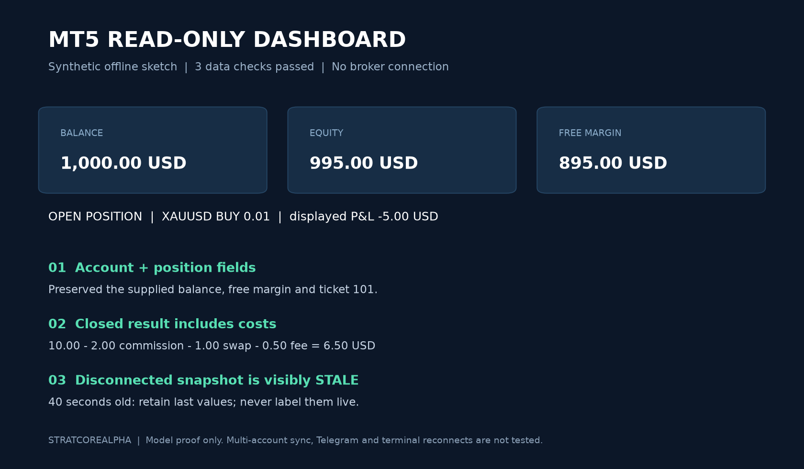

# Read-only MT5 dashboard: three data checks

An original offline sketch with synthetic account, position and closed-deal inputs.
It demonstrates field mapping, net-result arithmetic and explicit stale-data status.
It is not a finished MT5 collector or a broker connection test.

Run `python check_dashboard.py` with Python 3. No packages or credentials required.

1. Account balance 1,000 USD, free margin 895 USD and one open position are preserved.
2. Closed result: 10 gross - 2 commission - 1 swap - 0.50 fee = 6.50 USD.
3. A disconnected 40-second-old snapshot is marked STALE while retaining its values.

No orders are submitted. This sketch does not test terminal reconnects, actual feeds,
deal grouping, cash-flow handling, multiple accounts, Telegram or production hosting.
Those need separate implementation and acceptance against the funded scope.
